## Screenshots

### Home

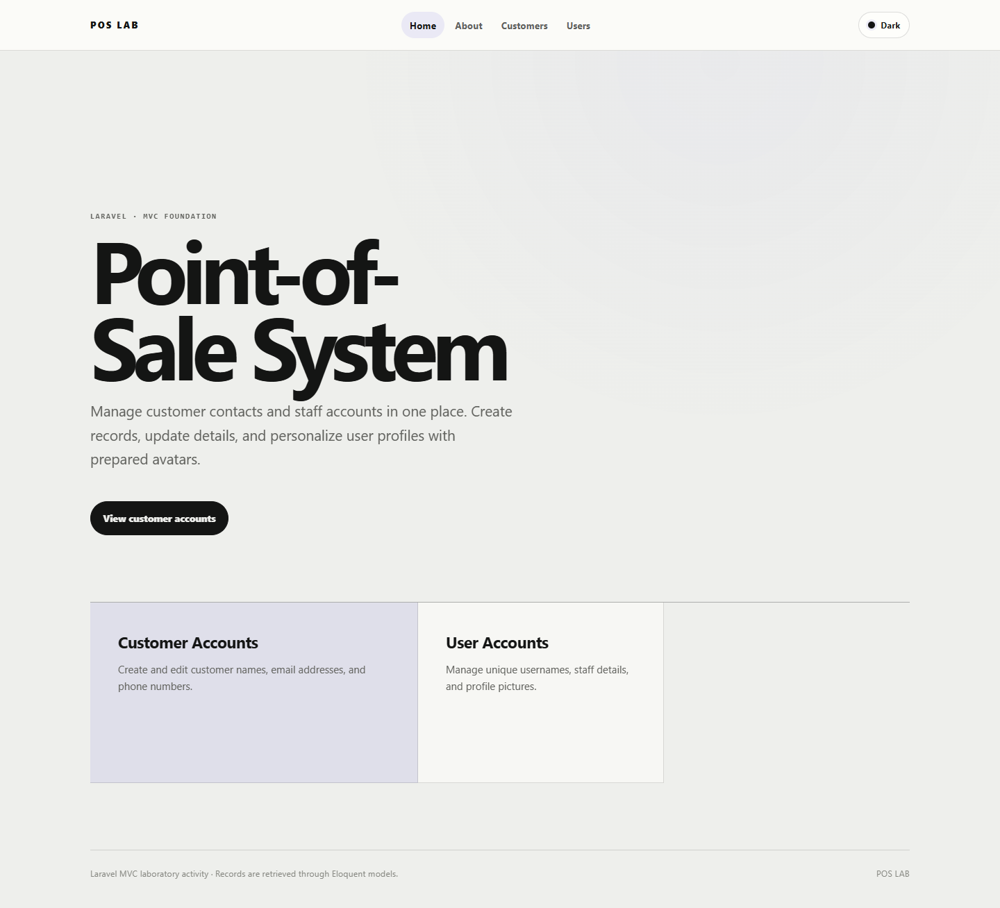

### Customer accounts

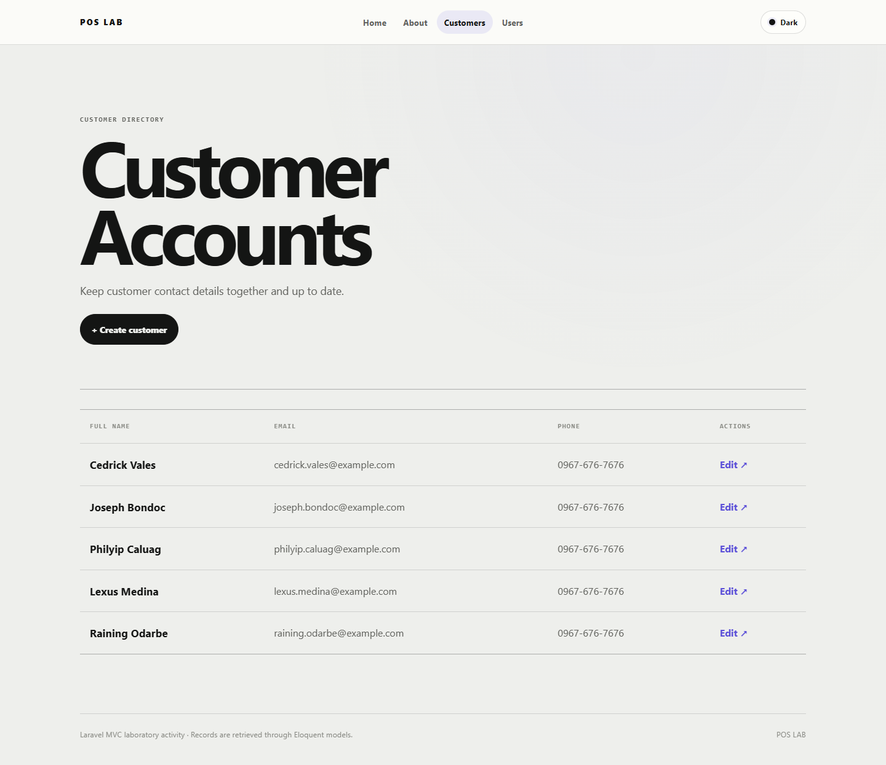

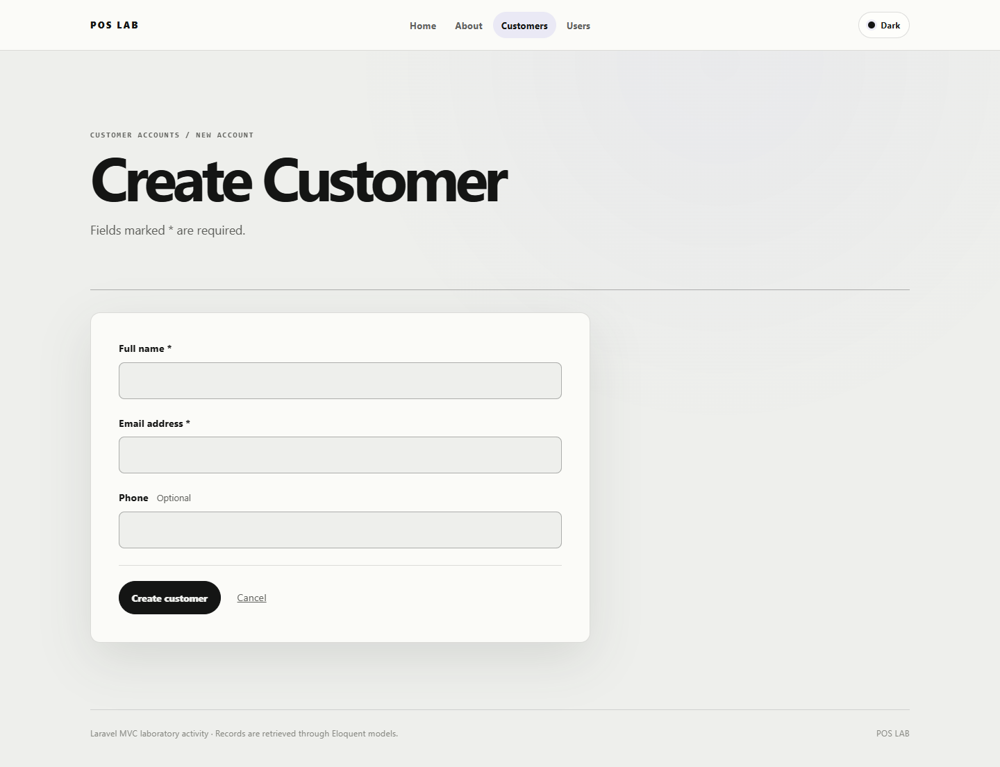

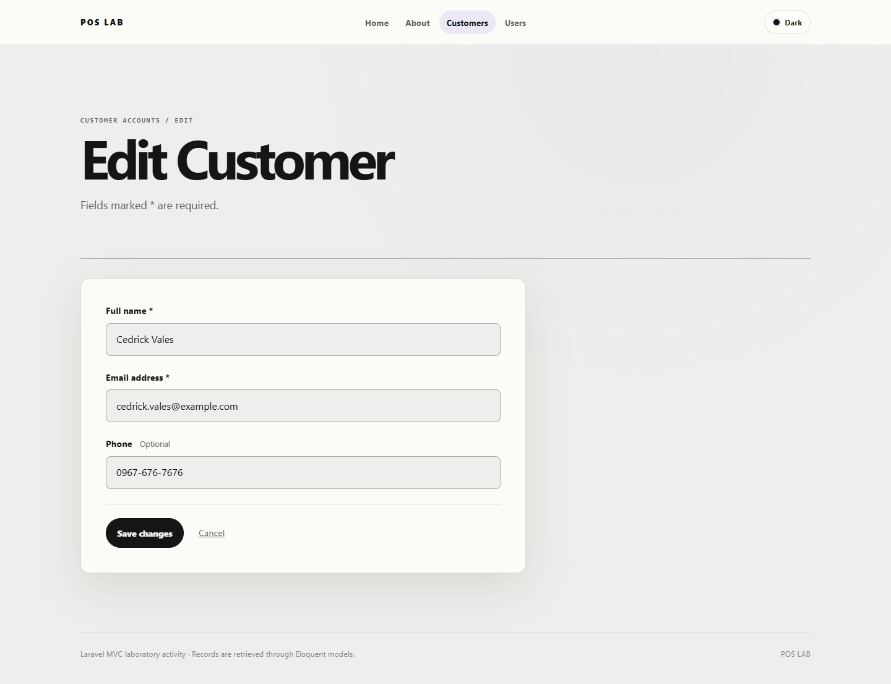

### User accounts

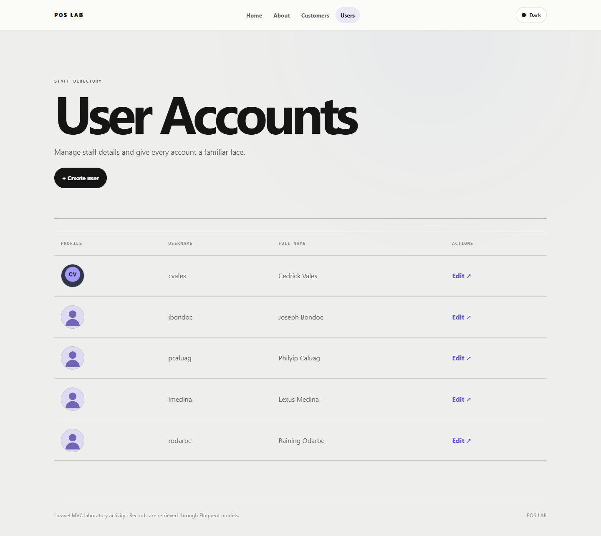

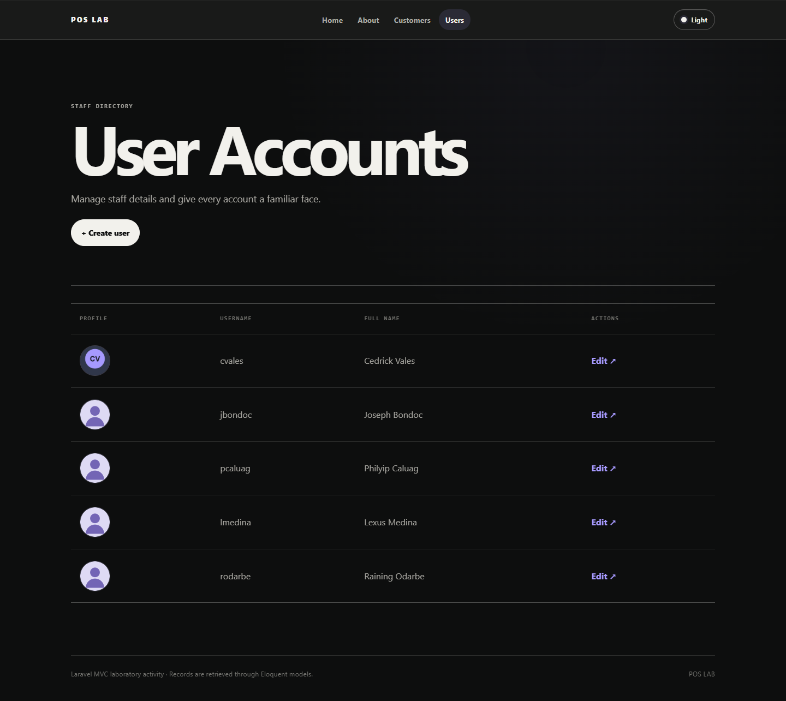

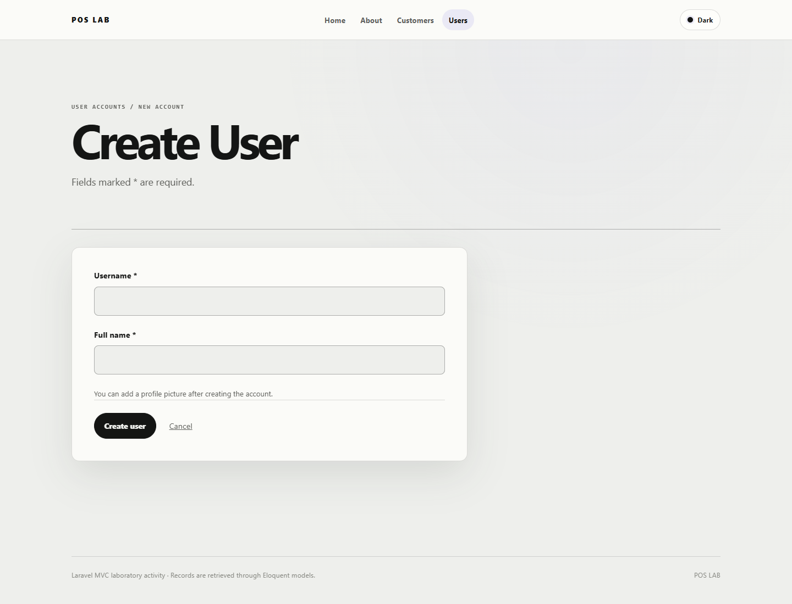

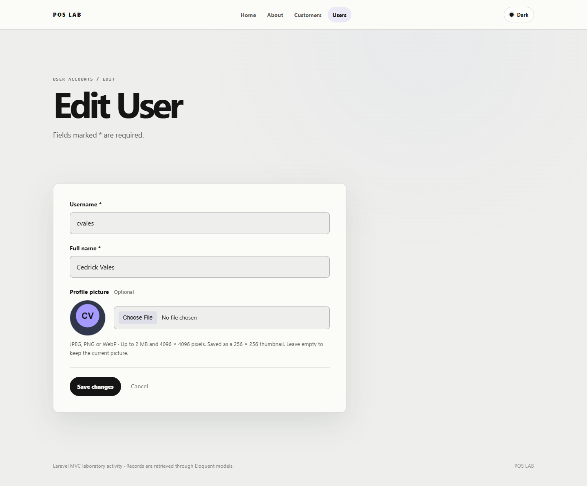

### Validation and mobile layout

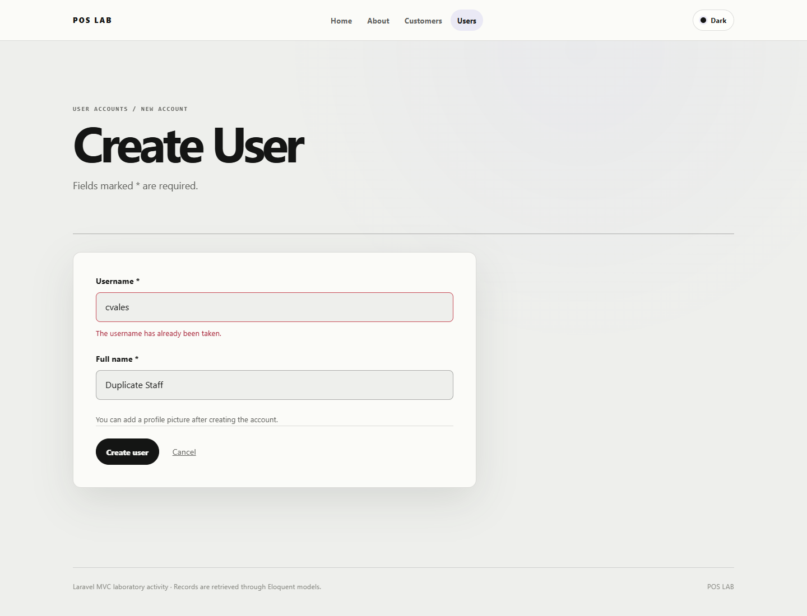

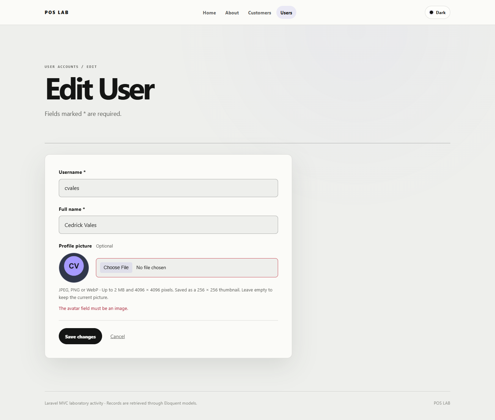

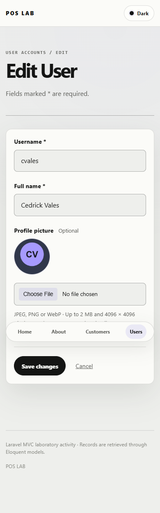

## Important additions

### Create and edit routes

[`routes/web.php`](routes/web.php)

```php
Route::resource('customers', CustomerController::class)
    ->only(['create', 'store', 'edit', 'update']);
Route::resource('users', UserController::class)
    ->only(['create', 'store', 'edit', 'update']);
```

Both edit pages use route model binding and `old()` to pre-fill saved values and preserve input after validation errors. Forms include CSRF protection; updates submit with `@method('PUT')`.

### Customer validation

[`app/Http/Controllers/CustomerController.php`](app/Http/Controllers/CustomerController.php)

```php
return $request->validate([
    'full_name' => ['required', 'string', 'max:100'],
    'email' => ['required', 'email', 'max:100'],
    'phone' => ['nullable', 'string', 'max:20'],
]);
```

### User validation

[`app/Http/Controllers/UserController.php`](app/Http/Controllers/UserController.php)

```php
$data = $request->validate([
    'username' => ['required', 'string', 'max:50', Rule::unique('users', 'username')->ignore($user)],
    'full_name' => ['required', 'string', 'max:100'],
    'avatar' => ['nullable', 'image', 'mimes:jpg,jpeg,png,webp', 'max:2048', 'dimensions:max_width=4096,max_height=4096'],
]);
unset($data['avatar']);
```

An existing user can keep their username. Another account's username is rejected. Image uploads accept JPEG, PNG and WebP up to 2 MB; the dimension limit bounds image processing memory.

### Avatar migration and model

[`database/migrations/2026_11_10_000004_add_avatar_to_users_table.php`](database/migrations/2026_11_10_000004_add_avatar_to_users_table.php)

```php
Schema::table('users', function (Blueprint $table): void {
    $table->string('avatar')->nullable();
});
```

[`app/Models/User.php`](app/Models/User.php)

```php
protected $fillable = ['username', 'full_name', 'avatar'];
```

The migration's `down()` method removes the new column. Existing users retain a null avatar and display the placeholder.

### Prepare and store the uploaded avatar

Intervention Image 3 uses the GD driver. Confirm that this package is approved by the instructor.

```php
$image = ImageManager::gd(decodeAnimation: false)
    ->read($request->file('avatar')->getPathname())
    ->cover(256, 256)
    ->toJpeg(quality: 85);

$newAvatar = 'avatars/'.Str::uuid().'.jpg';
Storage::disk('public')->put($newAvatar, (string) $image);
$data['avatar'] = $newAvatar;
```

The user edit form uses `enctype="multipart/form-data"`. Images are oriented, cropped and re-encoded as 256 × 256 JPEG thumbnails. Only the generated relative path is saved. Saving without an upload keeps the current avatar; replacement deletes the previous file after the account is saved. A failed database update removes the newly written file.

### Listing avatar and placeholder

[`resources/views/users/index.blade.php`](resources/views/users/index.blade.php)

```blade
avatar ? Storage::disk('public')->url($user->avatar) : asset('images/avatar-placeholder.svg') }}"
     alt="{{ $user->full_name }}'s profile picture">
```

### Required image and public storage setup

Enable PHP's GD extension before installing dependencies. Use a PHP version compatible with `composer.lock` (verified with PHP 8.5). From the project folder on a fresh checkout:

```powershell
composer install
Copy-Item .env.example .env
New-Item database/database.sqlite -ItemType File
php artisan key:generate
php artisan migrate --seed
php artisan storage:link
php artisan serve
```

`storage:link` exposes prepared images from `storage/app/public` through `public/storage`. Set `APP_URL` in `.env` to the address serving the app. Uploads and the local SQLite database are excluded from Git.
